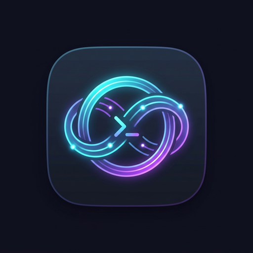

# Antigravity Remote SSH Proxy (ATP)

<div align="center">



# Antigravity Remote SSH Proxy Extension

**Visual UI Config · Interactive Connection Test · One-Click Status Bar · 100% Isolation · Zero System Pollution**

[English](./README.en.md) · [简体中文](./README.md)

</div>

---

## 💡 Why This Extension?

When developing remotely on Linux workstations via **Antigravity IDE** using Remote-SSH, the core AI services and background Language Server (`agy`) execute directly on the remote host. Users often face:
1. **Regional Restrictions**: `403 Forbidden: Your location is not eligible for this service at this time. Detected location: CN.`
2. **Timeouts & Connection Resets**: `TLS handshake timeout` or `connection reset by peer`.
3. **Environment Pollution Risks**: Modifying `~/.bashrc` with global proxy variables pollutes normal terminals, distributed training jobs, and internal LAN cluster services.
4. **Conflicting Development Scenarios**: Some tasks require proxy acceleration for AI assistants, while others strictly forbid proxies.

**This extension solves these issues with plug-and-play visual management**:
- 🖥️ **Interactive UI Settings Panel**: View and edit **Proxy Host** (e.g., `127.0.0.1`) and **Proxy Port** (e.g., `7897`) in a dedicated graphical panel with instant hot reload!
- 🚀 **One-Click Connection Test**: Run comprehensive diagnostic checks on SSH reverse tunnels, Google AI (`aicode.googleapis.com`), and telemetry endpoints with live latency and HTTP status feedback.
- ⚡ **One-Click Status Bar Toggle**: Switch between Proxy Mode and Pure Direct Connection mode in under 1 second.
- 🛡️ **Zero System Pollution**: Never alters `~/.bashrc` or `/etc/environment`. Local `ssh user@host` commands remain completely clean and warning-free.

---

## 📸 Key Features

### 1. Modern Visual Settings & Diagnostics Panel
Press `Ctrl + Shift + P` and search for `Antigravity Proxy: Open Settings & Test Panel`, or click the status bar item:
- **Proxy Configuration**:
  - **Proxy Host**: Target reverse tunnel host (default: `127.0.0.1`).
  - **Proxy Port**: Forwarded tunnel port (default: `7897`).
  - **Save Button**: Persists settings to IDE config and remote `~/.antigravity-ide-server/proxy.conf`, reloading `agy` instantly without restarting the IDE.
- **Connection Diagnostics**:
  - **Test Connection Button**: Probes the reverse tunnel port, tests Google AI endpoint responses, and displays PASS/FAIL badges with latency.

### 2. Status Bar Integration
- 🟢 **`$(plug) AI代理: 开启 (7897)`**: Reverse tunnel connected; AI traffic is accelerated.
- ⚪ **`$(circle-slash) AI代理: 纯直连`**: Pure direct connection; click to toggle or open settings.
- 🟡 **`$(warning) AI代理: 隧道未通`**: Target port is unreachable; click to troubleshoot SSH tunnel.

---

## 📦 Installation

### Option 1: Install from VSIX (Recommended)
1. Download `antigravity-remote-ssh-proxy-1.1.0.vsix` from Releases or the root directory.
2. In Antigravity IDE, go to Extensions (`Ctrl + Shift + X`).
3. Click `...` in the top right $\to$ **`Install from VSIX...`**.
4. Select the `.vsix` file.

### Option 2: Build from Source
```bash
git clone https://github.com/xuarehere/antigravity-remote-ssh-proxy.git
cd antigravity-remote-ssh-proxy
npm install
npm run package
```

---

## 📄 License

Licensed under the [MIT License](./LICENSE).
