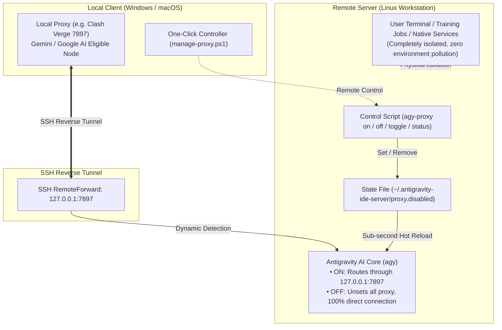

# Antigravity Remote SSH Proxy Manager

<div align="center">

**Lightweight, Secure, and Fully Isolated Network Acceleration & One-Click Toggle for Antigravity IDE Remote Development**

[English](./README.en.md) · [简体中文](./README.md)

</div>

---

## 📌 Background & Pain Points

When using **Antigravity IDE** for Remote-SSH development, the AI core and backend language servers (`agy`) run directly on the remote workstation. In environments where Google AI services (`aicode.googleapis.com` / `play.googleapis.com`) are restricted, developers commonly encounter:
1. **Regional Restrictions**: `403 Forbidden: Your location is not eligible for this service at this time. Detected location: CN.`
2. **Timeouts & Connection Resets**: `TLS handshake timeout` or `connection reset by peer`.
3. **Port Collisions**: If the remote server already runs a local proxy on 7897, standard SSH `RemoteForward` fails with `remote port forwarding failed`.
4. **Environment Pollution Risks**: Hardcoding `http_proxy` in `~/.bashrc` pollutes regular shells, training scripts, Docker, and affects other developers.

This project delivers a **complete, closed-loop solution**:
- **Dedicated Tunnel**: Direct connection to your local high-speed proxy via SSH reverse port forwarding.
- **Dynamic Scope**: Injects proxy variables exclusively into Antigravity IDE processes, **100% preserving the remote OS environment**.
- **One-Click Hot Reload**: Toggle between [Proxy ON] and [Pure Direct OFF] in 1 second without restarting the IDE window.
- **Clean Regular SSH**: Standard `ssh user@host` connections remain completely native, warning-free, and unpolluted.

---

## 🏗️ Architecture



---

## 🚀 Quick Start

### 1. Inside Remote Antigravity IDE Window (Recommended)

#### Option A: IDE Command Palette Task
Press `Ctrl + Shift + P` $\to$ type `Tasks: Run Task` $\to$ select:
- **`Antigravity 代理: 切换开启/关闭`** (One-click toggle)
- **`Antigravity 代理: 查看状态`** (Check status)
- **`Antigravity 代理: 强制开启 (ON)`** (Force Enable)
- **`Antigravity 代理: 强制关闭 (OFF - 纯直连)`** (Force Disable)

#### Option B: Integrated Terminal Command
```bash
agy-proxy on      # Enable proxy (Hot-reloaded in 1s, no window reload needed)
agy-proxy off     # Disable proxy (Reverts to pure direct connection)
agy-proxy toggle  # Toggle between ON and OFF
agy-proxy status  # Check current proxy and tunnel status
```

---

### 2. From Local Windows Client

```powershell
# Toggle proxy on target host
& ".\local\manage-proxy.ps1" -HostName "10.192.41.183-zbz-3090" -Action toggle

# Check target host status
& ".\local\manage-proxy.ps1" -HostName "10.192.41.183-zbz-3090" -Action status
```

---

### 3. Deploy to Any New Remote Server (Future Extensibility)

Deploy to any new SSH host (e.g., `10.3.3.107`, `10.192.41.70`) with a single command from your local machine:

```powershell
& ".\local\deploy-agy-proxy.ps1" -TargetHost "<SSH_Host_Name_or_Alias>"
```

---

## 📊 Mode Comparison

| Mode | Environment Variable `HTTP_PROXY` | Remote Server Behavior Without Proxy | Ideal Use Cases |
| :--- | :--- | :--- | :--- |
| **ON** | `http://127.0.0.1:7897` | **Routes via local high-speed tunnel** | AI completion/chat, accessing external packages |
| **OFF** | **Unset (Empty)** | **100% Direct Connection via physical NIC** | Internal cluster jobs, heavy data transfers, local LLMs |

---

## 📄 License

This project is licensed under the [MIT License](./LICENSE).
