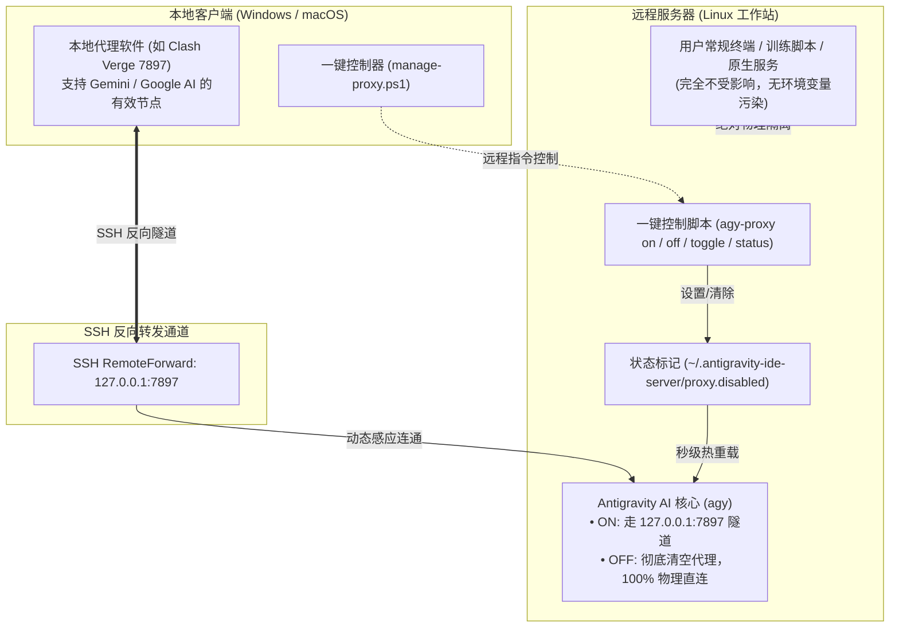

# Antigravity Remote SSH Proxy Manager

<div align="center">

**极简、安全、完全隔离的 Antigravity IDE 远程开发网络加速与一键切换方案**

[English](./README.en.md) · [简体中文](./README.md)

</div>

---

## 📌 背景与核心痛点

在使用 **Antigravity IDE** 进行 Remote-SSH 远程开发时，AI 核心服务和插件后台（Language Server / `agy`）直接运行在远程机器上。国内远程工作站访问 Google AI 服务接口（`aicode.googleapis.com` / `play.googleapis.com`）时，通常会遇到以下问题：
1. **地区限制拦截**：`403 Forbidden: Your location is not eligible for this service at this time. Detected location: CN.`
2. **连接超时与重置**：`TLS handshake timeout` 或 `connection reset by peer`。
3. **端口冲突与 SSH 警告**：若远程机器本身已安装 Clash（如监听 7897），常规 SSH 反向代理转发会报 `remote port forwarding failed` 导致隧道失效。
4. **系统环境污染风险**：粗暴地在远程机器 `~/.bashrc` 中写入全局 `http_proxy` 会污染普通终端、训练脚本与内网集群服务，并影响其他开发者。

本项目提供了**全链路闭环解决方案**：
- **独享通道**：通过独立的反向隧道直达本地优质代理。
- **动态注入**：只对 Antigravity 自身的专属进程注入代理，**100% 不污染远程系统环境**。
- **一键切换**：支持在 IDE 菜单与终端内一秒平滑切换【开启代理】与【纯直连】。
- **纯净普通 SSH**：日常通过 `ssh user@host` 登录时零警告、零多余转发、零残留。

---

## 🏗️ 架构原理



---

## 🚀 快速使用

### 1. 远程 IDE 窗口内使用（最推荐）

在 Antigravity IDE 远程连接状态下：

#### 方式 A：IDE 图形菜单一键切换
按下快捷键 `Ctrl + Shift + P` $\to$ 输入 `Tasks: Run Task`（运行任务） $\to$ 选择：
- **`Antigravity 代理: 切换开启/关闭`**（一键快速翻转）
- **`Antigravity 代理: 查看状态`**
- **`Antigravity 代理: 强制开启 (ON)`**
- **`Antigravity 代理: 强制关闭 (OFF - 纯直连)`**

#### 方式 B：内置终端一行命令
```bash
agy-proxy on      # 开启代理 (1秒平滑热重载生效，无需重启窗口)
agy-proxy off     # 关闭代理 (恢复纯直连模式)
agy-proxy toggle  # 开/关快速翻转
agy-proxy status  # 查看当前代理与隧道连接状态
```

---

### 2. 本地客户端随时遥控

在本地 Windows 电脑（无需先打开远程 IDE 窗口）：

```powershell
# 切换目标主机的代理开关
& ".\local\manage-proxy.ps1" -HostName "10.192.41.183-zbz-3090" -Action toggle

# 查看目标主机当前状态
& ".\local\manage-proxy.ps1" -HostName "10.192.41.183-zbz-3090" -Action status
```

---

### 3. 一键为新服务器装配（面向未来扩展）

未来连接到任意新的远程服务器（如 `10.3.3.107`、`10.192.41.70`）时，只需在本地执行一条命令：

```powershell
& ".\local\deploy-agy-proxy.ps1" -TargetHost "<SSH Host名称或别名>"
```

脚本将自动完成远端目录初始化、控制脚本安装、AI 核心包装和 IDE 任务注册！

---

## 📊 两种运行模式深度对比

| 模式 | 环境变量 `HTTP_PROXY` | 远程服务器未开启代理时 | 适用研发场景 |
| :--- | :--- | :--- | :--- |
| **开启 (ON)** | `http://127.0.0.1:7897` | **独享走本地高速代理** | 编写代码需 AI 补全/对话、访问外网依赖包 |
| **关闭 (OFF)** | **彻底清空 (unset)** | **100% 物理网卡纯直连** | 内网集群开发、大数据传输、本地大模型推理 |

---

## 📁 目录结构

```text
antigravity-remote-ssh-proxy/
├── README.md               # 中文文档
├── README.en.md            # 英文文档
├── LICENSE                 # MIT 开源许可证
├── .gitignore              # Git 忽略配置
├── local/                  # 本地端 (Windows/macOS) 工具
│   ├── manage-proxy.ps1    # 本地远程代理控制器
│   ├── deploy-agy-proxy.ps1# 通用一键部署工具
│   └── tasks.local.json    # 本地 IDE 任务配置模板
└── remote/                 # 远程服务端 (Linux) 组件
    ├── agy-proxy           # 服务端一键控制脚本
    ├── agy-wrapper.sh      # agy 动态代理包装脚本
    ├── patch-server.sh     # antigravity-ide-server 注入脚本
    └── tasks.remote.json   # 远端 IDE 任务配置模板
```

---

## 🔒 隔离与安全保障承诺

1. **零全局污染**：坚决不修改远端操作系统的 `/etc/environment`、`/etc/profile`、`~/.bashrc`、`~/.profile`。
2. **纯净 SSH 终端**：本地通过 `ssh user@host` 登录时零警告、零多余转发、零环境变量注入。
3. **多服务器独立**：每台服务器的开/关状态仅保存在自身的 `~/.antigravity-ide-server/` 私有目录中，多机并发互不影响。

---

## 📄 开源许可证

本项目基于 [MIT License](./LICENSE) 开源。
