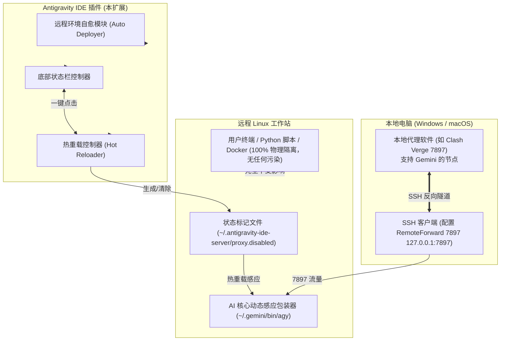

# Antigravity Remote SSH Proxy (ATP)

<div align="center">


# Antigravity Remote SSH Proxy 专属扩展

**即插即用 · 状态栏一键秒切 · 100% 物理隔离 · 零系统污染**

[English](./README.en.md) · [简体中文](./README.md)

</div>

---

## 💡 为什么需要这个插件？

在使用 **Antigravity IDE** 远程连接 Linux 工作站进行 Remote-SSH 远程开发时，AI 核心服务和后台（Language Server / `agy`）直接运行在远程机器上。国内远程工作站访问 Google AI 核心接口（`aicode.googleapis.com` / `play.googleapis.com`）时，通常会遇到：
1. **地区限制拦截**：`403 Forbidden: Your location is not eligible for this service at this time. Detected location: CN.`
2. **连接超时与重置**：`TLS handshake timeout` 或 `connection reset by peer`。
3. **环境污染顾虑**：直接在远程 `~/.bashrc` 中写入全局代理会污染普通终端、训练脚本与内网集群服务。
4. **不同研发场景的矛盾**：有时候需要翻墙使用 AI 辅助，有时候内网开发/本地大模型推理绝不能走代理。

**本插件实现了真正意义上的“即插即用”与“全自动管理”**：
- **状态栏一键切换**：底部常驻状态栏按钮，鼠标轻轻一点，1 秒内平滑热重载生效！
- **两种运行模式**：
  - **开启 (ON)**：独享走本地 7897 SSH 反向隧道，畅通访问 Google AI。
  - **关闭 (OFF)**：彻底清空代理变量，**远程机未开代理时 100% 物理直连**。
- **全自动探测与部署**：连接任何新的远程工作站时，插件自动在后台静默完成环境适配，无需手动复制脚本。
- **纯净 SSH 保证**：本地终端执行 `ssh user@host` 零警告、零多余转发、零环境污染。

---

## 📸 交互功能一览

### 1. 底部状态栏（Status Bar）
Antigravity IDE 底部常驻交互按钮：
- 🟢 **`$(plug) AI代理: 开启 (7897)`**：反向隧道连通中，点击立即切换为关闭。
- ⚪ **`$(circle-slash) AI代理: 纯直连`**：处于纯直连状态，点击立即开启代理。
- 🟡 **`$(warning) AI代理: 隧道未通`**：提示 7897 端口未监听，点击可快速查看排查指引。

### 2. 命令面板 (`Ctrl + Shift + P`)
输入 `Antigravity Proxy` 即可调用：
- `Antigravity 代理: 切换开启/关闭 (Toggle Proxy)`
- `Antigravity 代理: 开启 (Enable Proxy)`
- `Antigravity 代理: 关闭 (Disable Proxy)`
- `Antigravity 代理: 运行网络诊断 (Run Diagnostics)`
- `Antigravity 代理: 自动配置远端环境 (Setup Remote)`

### 3. 内置终端命令行支持
在远程内置终端中也可直接键入：
```bash
agy-proxy on      # 开启代理 (秒级生效，无需重启窗口)
agy-proxy off     # 关闭代理 (恢复纯直连模式)
agy-proxy toggle  # 一键翻转
agy-proxy status  # 查看状态与连通性
```

---

## 📦 安装方法

### 方式一：从 VSIX 安装（最简单，即插即用）
1. 从本项目 Release 或根目录获取 `antigravity-remote-ssh-proxy-1.0.0.vsix`。
2. 打开 Antigravity IDE，进入左侧扩展视图（`Ctrl + Shift + X`）。
3. 点击右上角菜单图标 `...` $\to$ 选择 **`Install from VSIX...`（从 VSIX 安装...）**。
4. 选择 `.vsix` 文件完成安装。
5. 连接远程服务器，底部状态栏即可自动显示并正常使用！

### 方式二：源码构建打包
```bash
git clone https://github.com/xuarehere/antigravity-remote-ssh-proxy.git
cd antigravity-remote-ssh-proxy
npm install
npm run package
```
打包成功后将在根目录生成 `.vsix` 文件。

---

## 🏗️ 架构原理解析



---

## 🔒 隔离与安全性设计

1. **绝对零系统污染**：
   - 绝不改动远程主机的 `/etc/environment`、`/etc/profile`、`~/.bashrc`、`~/.profile`。
   - 所有代理变量均只在 Antigravity 专有的进程树中流转。
2. **纯直连保障**：
   - 在关闭（OFF）模式下，插件显式 `unset` 所有代理变量。远程机若未开代理，所有连接均为物理网卡纯直连。
3. **多服务器独立隔离**：
   - 每台服务器的状态仅保存在自身服务器的私有配置目录下，多台服务器并发工作时互不干扰。

---

## 📄 开源许可证

本项目基于 [MIT License](./LICENSE) 开源。
